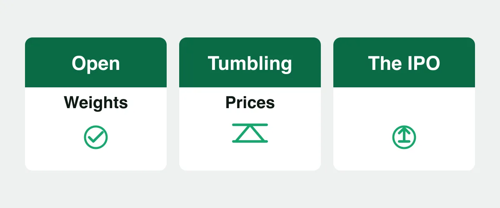

Every Sunday we read what lit up Hacker News and pick the stories that matter to people who build software and run a business. This digest covers 25 October to 1 November 2026, and the week had one story underneath all the noise: the model economy is now moving faster than the businesses that buy into it. Anthropic filed for an IPO, Mistral opened a trillion-parameter model, OpenAI cut prices again, and the analysis community noticed. Points below are as of 1 November 2026, they move fast and mean little on their own.

## 1. Anthropic files for an IPO

Anthropic filed a registration statement on Form S-1 with the SEC for a proposed initial public offering of its Class A common stock, planning to list on the Nasdaq Global Select Market under the symbol ANT ([source](https://www.anthropic.com/news/s1-sec), 1,709 points on Hacker News, 26 October 2026). The number of shares and the price range are not determined yet, and the company keeps an unusual structure: it is a public benefit corporation, and a Long-Term Benefit Trust controls a majority of the board through a special class of stock. My take: the filing is the market's first hard look at AI unit economics, and the governance answer will be copied by every founder who wants safety control to survive a public life.

## 2. Mistral opens the weights of a trillion-parameter model

Mistral released the weights of Mistral Large 4, its 1-trillion-parameter multimodal MoE model, under a modified MIT license that requires a commercial license only for Model-as-a-Service resellers ([source](https://mistral.ai/news/mistral-large-4-oss/), 1,709 points on Hacker News, 29 October 2026). The vendor claims it leads open-weight coding benchmarks and defensive security scores, and prices its API at $0.70 input and $2.10 output per million tokens. This is a vendor announcement from Mistral, a company that sells model access and cloud capacity, so take the benchmark leads as claims to verify, not facts. My take: the real news for a business is sovereignty. A frontier-class model you can download, audit, and fine-tune changes what a data policy can and cannot allow.

## 3. OpenAI ships GPT-6.1 Terra at half the price

OpenAI introduced GPT-6.1 Terra, its fast and efficient model for everyday work, at $1 per million input tokens and $5 per million output tokens, 50% lower than its GPT-5.6 Terra and GPT-6.1 Sol ([source](https://openai.com/index/introducing-gpt-6-1-terra/), 637 points on Hacker News, 26 October 2026). OpenAI reports gains in visual reasoning, computer use, and writing, and claims an error rate drop on its own internal benchmark from 53.6% to 16.7% at low reasoning effort; those are vendor-measured numbers, not independent tests. My take: the interesting move is positioning, not capability. A cheap tier aimed at high-volume work like invoice processing is how a lab sells to back offices, not just to developers.

## 4. OpenAI and Anthropic cut LLM prices by up to 80% in a few months

Max Woolf, the independent analyst behind minimaxir, documented a price war: from June to now, OpenAI and Anthropic cut flagship and small-model prices by up to 80%, with cache-read costs the hidden lever that cuts effective agent spend by 70-75% ([source](https://minimaxir.com/2026/10/cheap-llms/), 443 points on Hacker News, 25 October 2026). His timeline links every cut to its primary announcement, and he attributes the pressure to open-weight substitutes like DeepSeek and to dozens of competing inference providers on OpenRouter. My take: models are becoming a commodity faster than expected, and the strategic question flips. Nobody wins on the API price alone, so the winners will be the ones who own the workflow around the model.

## 5. SigNoz asks whether AI is deskilling its own users

SigNoz, the open-source observability company, published an essay arguing that AI does not replace SREs, it deskills them: when an agent handles the routine incidents, the human loses the practice needed for the rare novel outage ([source](https://newsletter.signoz.io/p/ai-isnt-replacing-sres-its-deskilling), 655 points on Hacker News, 30 October 2026). It leans on the 1983 paper "Ironies of Automation" and on a Lancet study where AI-assisted endoscopists got worse without the tool. Label this one: SigNoz sells observability and builds AI features into its product, so the essay also argues for its own design choice. My take: the deskilling loop is real, and it applies to every team that offloads judgment, not just SREs. The fix is to keep humans in the loop as practitioners, not supervisors.

## What it means for us

Here is where I stop summarizing and take a position.

This week gives you the whole arc in four days. Anthropic files to go public, Mistral gives away frontier weights, OpenAI prices a workhorse model 50% lower, and the analysts show 80% price cuts in a few months. The scarce thing is no longer intelligence. It is the operator: the team that can define what the model may touch, measure the result, and stay sharp when the automation fails.

So do not buy a strategy that depends on one vendor's model staying valuable. Buy one that depends on your workflow, your data, and your people. Cheap frontier models are the best thing that has happened to a judgment-driven business in a decade, and the teams that practice judgment deliberately are the ones that will own the 5% of the work that actually matters.

We build technology around human judgment for exactly this reason. Cheap models are the raw material, the judgment of the operator is the product. If that sounds like the right trade for your business, we would love to talk. ([Contact](/contact/))

