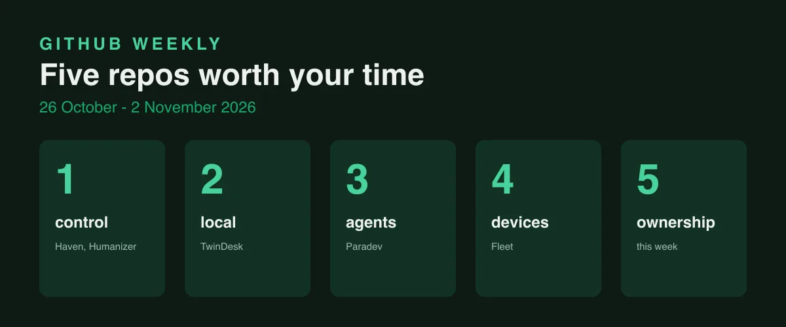

Every Monday we take a lap around [r/BestGitHubRepos](https://www.reddit.com/r/BestGitHubRepos/) and pick five projects worth your time. The bar is simple: real stars, a recent release, and something that changes how you build or create. Here is the set for this week, covering the window from 26 October to 2 November 2026. Stars and release data are as of 2 November 2026, checked on GitHub.

## 1. Haven, a remote workstation in your pocket

Haven ([repo](https://github.com/GlassHaven/Haven)) is a free SSH, VNC, RDP and SFTP client for Android, and the feature list is startling: remote desktops, port forwarding, per-app WireGuard and Tailscale tunnels, a Linux userland in PRoot, and even a whole user-mode Linux kernel, all without root. It is Kotlin, AGPL-3.0, with about 1,400 stars, and the latest release is [v5.93.2 from 2 November](https://github.com/GlassHaven/Haven/releases).

My take: this is what "your phone is a computer" finally means. One app replaces a dozen remote admin tools, and it still talks to the network when there is no network, over a Reticulum mesh. The privacy positioning is part of the product: no telemetry, biometric lock, encrypted backups.

## 2. blader/humanizer, a skill that fights AI-sounding text

Humanizer ([repo](https://github.com/blader/humanizer)) is an agent skill by Siqi Chen that rewrites AI-generated text so it reads like a person wrote it, without changing the meaning. It checks 26 named patterns, from "not X but Y" to one-line closers, instead of working on vibes. It is Python, MIT, with about 64,000 stars, and the latest release is [v3.1.0 from 28 September](https://github.com/blader/humanizer/releases).

My take: I like that it names the tells. A writer who knows why a sentence sounds generated is a better writer, whether the text is human or machine. The star race around it says many people now care about the difference, which is new.

## 3. Fleet, device management as GitOps

Fleet ([repo](https://github.com/fleetdm/fleet)) is an open source platform for IT and security teams that manage thousands of computers. It does MDM, patching and vulnerability management for Linux, macOS, Windows and Chromebooks, with workflows that are API-first: GitOps, YAML, webhooks and the fleetctl CLI. It is mostly Go, with about 7,100 stars, and the latest release is [fleet-v4.94.0 from 28 October](https://github.com/fleetdm/fleet/releases).

My take: patching is the least glamorous job in IT and the most important one. Every agent you deploy inherits the state of the machines it runs on, and unpatched devices are how real breaches start. The boring layer keeps winning.

## 4. Paradev, an IDE that runs an army of agents

Paradev ([repo](https://github.com/ParadevAI/Paradev)) is a desktop app for running CLI coding agents in parallel. Each task gets its own Git worktree and branch, so Claude Code, Codex, OpenCode or any other agent can work on several tasks in the same repo at once, and you review and merge from one window. It is TypeScript, with about 16,000 stars, and the latest release is [desktop-v2.0.3 from 1 November](https://github.com/ParadevAI/Paradev/releases). One honest caveat: the code is source-available under the Elastic License 2.0, and the company itself notes it is not OSI-approved open source ([paradev.com](https://paradev.com/)).

My take: once agents can do the work, the bottleneck moves to review and merge. A tool that makes parallelism visible and reviewable, with your own agent subscriptions, is the pragmatic next step. I respect the license label: clear, honest, no "open core" theater.

## 5. TwinDesk, one desk for all your hardware

TwinDesk ([repo](https://github.com/InukaAsith/TwinDesk)) turns every computer and phone you own into one working surface: one mouse and keyboard, shared clipboard, files and notifications, with your Android phone as a full peer and its apps in windows. No account, no cloud, devices talk directly on the local network or over USB. It is JavaScript with native helpers, GPL-3.0, and the latest release is [v2.4.0 from 28 October](https://github.com/InukaAsith/TwinDesk/releases). The subreddit post reported just over 800 stars on Sunday; the GitHub API showed 2,872 on 2 November, in a repository created on 14 October.

My take: the indie underdog of the week. From just over 800 stars in a Sunday subreddit post to 2,872 via the GitHub API today is a fast move, whatever the community baseline. Local-first tools like this are the counterweight to everything being a cloud subscription, and people are voting with stars.

## What connects this week

Five tools, one instinct: take back the parts of computing that moved into someone else's cloud. Haven puts a full remote workstation in your pocket with no telemetry. TwinDesk keeps every screen and file on your own network. Fleet manages your devices from your own infrastructure. Paradev runs your agents with your own subscriptions. Humanizer gives you a say in how your text sounds. The theme is control: of devices, of agents, of data, of voice.

My honest position: local-first and self-hosted tools quietly turned from nostalgia into strategy. When agents start doing real work, the questions shift from features to ownership: whose network, whose devices, whose agents, whose text. Every repo in this window answers "yours". I also notice the honesty around licenses. Paradev says plainly it is source-available, not open source. That clarity beats a misleading label, and it is the kind of trust that matters when you bet a product on a codebase.

We are a boutique consultancy that ships AI to clients. We build systems where the agent proposes and a person decides, and we care about control: over models, over data, over deployment. If you want agents that work inside your guardrails, we are here. ([Contact](/contact/))