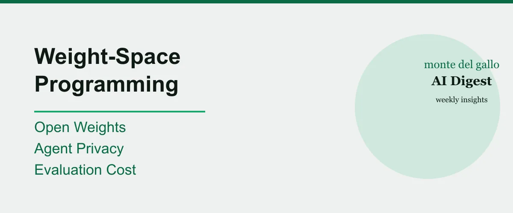

Every Sunday we read what lit up Hacker News and pick the stories that matter to people who build software and run a business. This digest covers 2 to 8 November 2026, and the week had one thread through it: the weights themselves are becoming the object of AI work. A lab showed a frontier model reading and editing raw network weights, two open-weight models landed, and the community argued about what agents leak and what judging them should cost. Points below are as of 8 November 2026, they move fast and mean little on their own.

## 1. A frontier model can read and edit neural network weights

MIT CSAIL researchers, including Omar Khattab, published early results in weight-space programming: GPT-6 Astra can read raw weights and tell what a network was trained to do, write small game-playing networks from scratch that beat PPO-trained ones, and fix Qwen3.5-0.8B by editing 0.016% of its weights, lifting MATH-500 from 7.9% to 48.1% without gradients ([source](https://rikiyat.github.io/blog/weight-space-programming/), 2,960 points on Hacker News, 2 November 2026). The work is a blog post with released experiment logs, not peer-reviewed, and the authors call the results early sparks, so take the numbers as lab-measured claims rather than settled fact. My take: this is the rare story that quietly changes what "optimize a model" will mean. If an LLM can reason about weights instead of only pushing gradients, the training loop stops being a black box you rent and starts being something you can inspect.

## 2. Kimi opens the weights of a 3T-class agentic model

Moonshot AI released Kimi K3.1 Pro as open weights on Hugging Face: a natively multimodal agentic model, its most capable 3T-class model to date, post-trained from Kimi K3, with a 1-million-token context and gains in coding, 3D creation, financial research, and factual accuracy ([source](https://huggingface.co/moonshotai/Kimi-K3.1-Pro), 637 points on Hacker News, 4 November 2026). The benchmark tables are vendor-published by Moonshot, an inference seller, so treat them as claims to verify rather than independent results. My take: weights this capable, downloadable and inspectable, keep pushing the same decision up the stack. Whether a business can actually host them depends on two things the announcement does not promise: the license, which is Moonshot's own Kimi K3.1 Pro license rather than a permissive open one, and the hardware, since a 2.8-trillion-parameter MoE with 104 billion activated is not a commodity single-GPU model. Ownership for data that cannot leave the building only wins where both hold.

## 3. Agent privacy hit the front page this week

A GitHub issue on the Claude Code repository reported that the tool sends your email address in the User-Agent header to websites it visits, and the community pile-on reached 1,596 points ([source](https://github.com/anthropics/claude-code/issues/107757), 5 November 2026). The reporter ran version 2.1.318. On 5 November, Claude Code contributor poteat wrote in the thread that a built-in mod, cc-plugin-privacy, deterministically blocks the behavior in v2.1.317 and later, that it is enabled by default and can be turned off via /plugins. That is a statement in an open issue, not an independently verified release: the issue is still open, no pull request is linked, and the reporter was already on 2.1.318 when the leak was reported, so the version numbers do not obviously reconcile. The takeaway is more general than this one tool: every agent that browses the web on your behalf now carries a fingerprint of who you are. My take: this is a real credibility test for AI agents in the enterprise. The tool that phones home the least, and documents it, earns the deployment.

## 4. LLM judging for identity resolution got a lot cheaper

Hightouch, a customer data platform, tested whether cheap decision models could grade identity resolution as well as frontier LLMs, and found a hybrid Jev + Opus setup reaches near-Opus accuracy at over 4x lower cost, with Jev alone at $0.05 per 1,000 identities and 0.15 seconds each ([source](https://hightouch.com/blog/llm-judges-identity-resolution), 584 points on Hacker News, 6 November 2026). This is a vendor study by a company that sells identity resolution and profiling, so it doubles as product marketing for its own workflow; the numbers are the vendor's own measurements. My take: in the vendor's identity-resolution tests the pattern is real: Jev's confidence is better calibrated than Luna's, most of its mistakes carry low confidence, and routing those cases to Opus on a threshold recovers frontier accuracy at lower cost. Whether it generalizes to every high-volume review loop is a test, not a given; the mechanism is demonstrated on their workflow with their thresholds.

## 5. Lower-cost models are changing what gets built

No single story captures this better than the cost pressure visible across the week: Ripple-65B, a US open-weight model, claims state-of-the-art agentic coding results for a reported one-tenth of the training cost of comparable efforts, at a stated $32M full R&D bill from scratch ([source](https://www.ricursive.com/ripple), 340 points on Hacker News, 4 November 2026). The cost claim is the lab's own, from Ricursive, a company selling a model, so verify before repeating it as fact. My take: the real signal is not the number, it is that a lab now claims a leading open model was built from scratch at $32 million, the previous open-weight agentic-coding SOTA's cost being roughly ten times that by its own estimate. If that holds, the entrance fee for a serious open model drops by an order of magnitude; the claim, not the trend, is what needs verification before it becomes a strategy.

## What it means for us

Here is where I stop summarizing and take a position.

This week points in one direction: the models are becoming readable, and that is good news for your business. When a lab shows a frontier model reading and editing neural network weights, and open weights keep landing at a fraction of the old cost, the implication is the same from two angles. Intelligence is becoming inspectable and ownable again. You can look at what the model is doing, host it if you need to, and run agents that cost less per judgment than a spreadsheet error.

But the same week carried the warning. Agents leak your identity on the web, and the companies that sell you AI are measuring results on their own benchmarks with their own products in the work. So the selection criteria for an AI vendor are getting clearer, not barer. Do they publish weights you can audit? Do they document what the agent sends where? Are their performance claims independently verifiable, or only in their own spreadsheets?

We build technology around human judgment for exactly this reason. Readable, trustworthy, and cheap models are the raw material. Your judgment over what they touch is the product. If that trade sounds right for your business, we would love to talk. ([Contact](/contact/))

