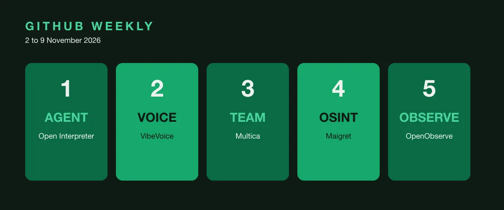

Every Monday we take a lap around [r/BestGitHubRepos](https://www.reddit.com/r/BestGitHubRepos/) and pick five projects worth your time. The bar is simple: real stars, an active repository, and something that changes how you build or create. Here is the set for this week, covering the window from 2 November to 9 November 2026. Stars and release data are as of 9 November 2026, checked on GitHub.

## 1. Open Interpreter, a coding agent for open models

Open Interpreter ([repo](https://github.com/openinterpreter/openinterpreter)) is a coding agent for open models like Kimi K3 and GLM 5.3, written in Rust. That is how GitHub describes it: an agent that runs on open weights rather than a vendor's cloud. It is Apache-2.0, with 68,845 stars, and the latest release is [rust-v0.0.60 from 9 November](https://github.com/openinterpreter/openinterpreter/releases).

My take: Open Interpreter is one of the oldest names on this list and it keeps moving. The direction now is clear, a coding agent that does not lock you into one model vendor. For a consultancy that ships AI inside client guardrails, that matters more than any single feature.

## 2. Microsoft VibeVoice, open source voice AI

Microsoft published [VibeVoice](https://github.com/microsoft/VibeVoice), an open source stack for text to speech and speech recognition. The repo calls it frontier voice AI, with one-pass, multi-speaker, real-time output; that claim is theirs, not a benchmark we ran. It is Python, MIT, with 56,857 stars. There are no tagged releases yet.

My take: the event is Microsoft putting a voice model stack in the open with an MIT license. Voice is the interface agents will talk through, and if the weights are public, the lock-in moves out of the picture. Watch the space between this and the agent picks below.

## 3. Multica, agents that show up on the board

[Multica](https://github.com/multica-ai/multica) is a workspace where coding agents work like teammates: they get an issue, pick it up, run on a runtime you control, report progress and hand the result back for review. It works with the CLIs you already use, Claude Code, Codex, Cursor and Kimi. It is Go, with 55,397 stars, and the latest release is [v0.8.1 from 6 November](https://github.com/multica-ai/multica/releases).

My take: this is the missing middle between an agent in a terminal tab and a heavy platform. Name the agents, give them runtimes, put them on a shared board, keep a human in the review loop. License honesty note: the project says open source, but the license is Apache 2.0 text plus extra conditions on hosted services and branding, so it is source-available, not OSI-approved.

## 4. Maigret, a dossier from a username

[Maigret](https://github.com/soxoj/maigret) collects a dossier on a person by username, checking more than 6,000 websites. It is Python, MIT, with 39,885 stars, and the latest release is [v0.6.6 from 18 September](https://github.com/soxoj/maigret/releases).

My take: for security teams it is an investigation starter. For the rest of us it is a privacy audit. Run it on your own username and see how much of you is public. Tools like this do not create the exposure, they show it, and that is worth knowing before an agent does.

## 5. OpenObserve, observability with LLM tracing

[OpenObserve](https://github.com/openobserve/openobserve) is an observability platform for logs, metrics, traces, session replay, SLOs and LLM observability, positioned as an alternative to Datadog, Splunk and Elasticsearch. It ships as a single binary, and the project claims 140x lower storage costs; that number is their claim, not an independent benchmark. It is TypeScript, AGPL-3.0, with 22,949 stars, and the latest release is [v1.2.0-rc1 from 4 November](https://github.com/openobserve/openobserve/releases).

My take: LLM observability in an open, self-hosted platform is the right tool once agents hit production. You cannot trust an agent you cannot watch. Token spend, traces and agent decisions belong in the same dashboard as the rest of your stack, and this repo points that way.

## What connects this week

Five tools, one pattern: the operations layer of AI. Open Interpreter runs agents on open models. Multica coordinates them on a shared board. OpenObserve watches them in production. VibeVoice gives you the voice layer to build on. Maigret maps the open web. The common theme is not another chat demo. It is the plumbing around agents: run them, coordinate them, observe them, speak through them.

My honest position: agents stopped being a demo and became a workload, and the week's picks are the infrastructure that workload needs. I also want the license honesty to become standard. Multica calls itself open source and the license carries real conditions; say what it is and let people decide. We build systems where agents propose and a person decides, and trust is earned in the observability layer, not in the demo. That is where this week's repos point.

We are a boutique consultancy that ships AI to clients. We build systems where the agent proposes and a person decides, and we care about control: over models, over data, over deployment. If you want agents that work inside your guardrails, we are here. ([Contact](/contact/))