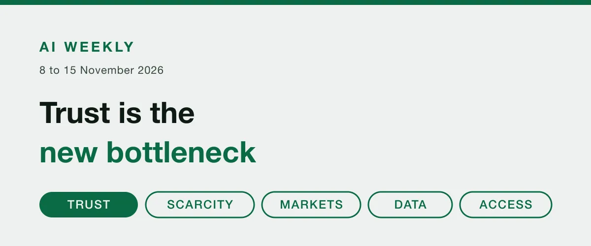

Every Sunday we read what lit up Hacker News and pick the stories that matter to people who build software and run a business. This digest covers 8 to 15 November 2026, and the week had one thread through it: trust. Where is supply real? Whose numbers can you check? What does an agent get to do with your money? Points below are as of 15 November 2026, they move fast and mean little on their own.

## 1. Nvidia allegedly funded demand to keep GPU prices high

TechPowerUp summarized a Wall Street Journal profile reporting that Nvidia allegedly engineered scarcity by funding AI startups that then bought its GPUs, pushing more deals in mid to late 2026 to absorb an oversupply of TSMC wafers and keep prices up ([source](https://www.techpowerup.com/354814/nvidia-allegedly-engineered-scarcity-by-funding-ai-startups-to-buy-its-gpus/), 1,077 points on Hacker News, 14 November 2026). The claim is single-source: the report relies on unnamed people familiar with the matter, the WSJ original sits behind a paywall, and Nvidia has previously disputed the circular financing framing. My take: treat it as an allegation with a clear incentive, not a finding. It still matters, but only if the reporting is accurate: if part of the demand is funded by the supplier, then the GPU shortage is not only physics, and capacity planning is pricing a policy choice, not a hard limit.

## 2. Anthropic opens its IPO roadshow

Anthropic's IPO site went live this week with the roadshow starting November 10, the final share price expected November 18, and shares expected to begin trading November 19 on Nasdaq under the ticker ANT ([source](https://ipo.anthropic.com/us/), 1,002 points on Hacker News, 12 November 2026). The company reports $17.0 billion in Q3 2026 revenue, up more than 12 times year over year, at least 11,900 customers spending $100,000 or more in trailing twelve month revenue, and a net loss of $23.3 billion that includes a $21.9 billion non-cash charge from changes in convertible note, derivative liability and SAFE valuations. My take: the filings give outsiders a document to audit in a sector built on vendor claims, but read the two halves separately. The customer count and revenue speak to demand; the non-cash charge is accounting movement, not cash spent, and on its own proves neither too much about the boom nor too little.

## 3. Claude Fable 5.2 and Mythos 5.2

Anthropic released Claude Fable 5.2 and Claude Mythos 5.2 on November 9: the same underlying model, with Fable carrying cybersecurity and biology safeguards for general availability and Mythos gated behind the Life Sciences and Cyber Verification Programs ([source](https://www.anthropic.com/claude-fable-and-mythos-5-2/), 1,000 points on Hacker News, 9 November 2026). Base pricing is $8 per million input tokens and $40 per million output tokens, with a fast mode up to 2.5 times faster billed at $16 and $80. Anthropic's own evals put Fable 5.2 at 49.1% on FrontierCode 2.0 at Xhigh effort, which the company calls the highest score of any released model it has tested, and near-parity with Opus 5.5 at roughly half the cost per task. Those are vendor measurements from a company selling the models; the announcement itself notes that external organizations cited do not necessarily agree with its claims. My take: the honest headline is not the score, it is the tiering. The same weights ship through two release gates, so capability is now packaged by risk. That is the shape of enterprise AI going forward: you choose the version your policy allows you to run.

## 4. Lovable apps exposed data without a login

Hamburg security firm Crissy Field GmbH, reporting with the German daily Handelsblatt, examined 159,041 Lovable projects focused on its Supabase integration, the most widely used database service among them, and found 24,664 sites that sent database records on page load without a login, with email records in 10,560 tables across 7,403 of those sites ([source](https://www.crissyfield.de/research/lovable-en/), 868 points on Hacker News, 14 November 2026). The worst cases: a German forum with more than 80,000 profiles and more than 200,000 chat messages, and a provider with more than 1,000 records holding passport details. The report is careful: it could not establish that any data was misused, and not every site that loads data risks a breach. Lovable has said the problem is industry-wide and that its terms put data responsibility on customers. My take: this is the bill for AI app builders coming due. The tool generates the app, but the liability for an open database lands on whoever ships it. Defaults are part of the product.

## 5. United Airlines bans AI agents from booking flights

United said on November 11 that it prohibits AI agents from making flight reservations on behalf of travelers, citing security risks and the risk of violating federal rules, and it will restrict access both directly on its own platforms and indirectly via travel agencies and aggregators ([source](https://www.cbsnews.com/news/united-airlines-bans-ai-agents-booking-flights/), 680 points on Hacker News, 11 November 2026). The airline says sharing account credentials with third-party AI assistants can expose sensitive information and lead to unintended purchases or use of MileagePlus miles. Aggregators like Kayak, Hopper and Google Flights still book United fares, and Southwest is taking the opposite route by making its inventory viewable inside ChatGPT. My take: the credential-sharing model of agentic commerce just hit a wall. Agents that book in your name need sanctioned channels, and United drew the line at a federal attestation, not at the API. Build for the channel the merchant controls, not for the one you hoped for.

## What it means for us

Here is where I stop summarizing and take a position.

The week reads like a trust audit of the industry. GPU supply is questioned, so you check the numbers. A frontier lab goes public, so you read the filings. A model vendor posts its own benchmarks, so you wait for independent evals. A generated app leaks, so you scan your own stack. An airline cuts off agents, so you ask who holds the channel.

The position: verification is the product. The businesses that win this cycle will be the ones that treat every vendor number as a claim to audit, every generated default as a risk to close, and every access grant as a permission to revoke. Anthropic's roadshow puts frontier AI on the public market, and public markets are the most demanding verifiers that exist. The rest of the industry should get used to the same standard.

We build technology around human judgment for exactly this reason. The human checks the machine, reads the filing, opens the app, and owns the decision. If that trade sounds right for your business, we would love to talk. ([Contact](/contact/))

