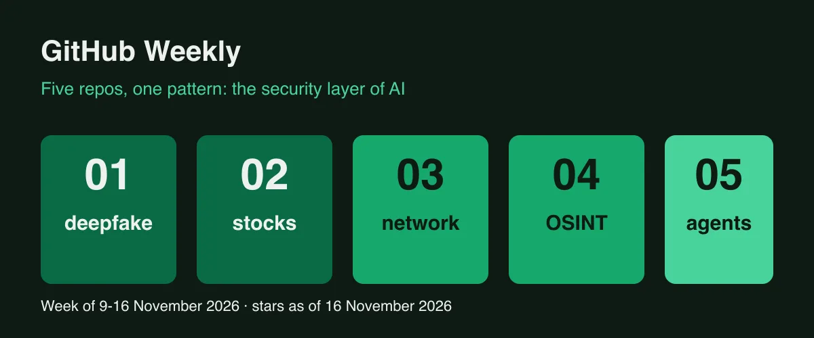

Every Monday we take a lap around [r/BestGitHubRepos](https://www.reddit.com/r/BestGitHubRepos/) and pick five projects worth your time. The bar is simple: real stars, an active repository, and something that changes how you build or create. Here is the set for this week, covering the window from 9 November to 16 November 2026. Stars and release data are as of 16 November 2026, checked on GitHub.

## 1. Deep-Live-Cam, the deepfake tool that keeps moving

[Deep-Live-Cam](https://github.com/hacksider/Deep-Live-Cam) is real-time face swap and one-click video deepfake from a single image. It is Python, AGPL-3.0, with 98,164 stars, and the latest release is [DeepLiveCam 2.8 from 22 October](https://github.com/hacksider/Deep-Live-Cam/releases). The project is honest about what it is: a tool that makes synthetic faces, with instructions on consent.

My take: this is the risk side of the week, and I want it on the list precisely because of that. A tool with 98k stars and a single image can put words in a person's mouth. Anyone building trust systems, and we do, needs to know what this class of software can do today. The release cadence is the signal: it is not a toy, it is maintained software.

## 2. daily_stock_analysis, an LLM stock analyst on schedule

[daily_stock_analysis](https://github.com/ZhuLinsen/daily_stock_analysis) is an LLM-powered, multi-market stock analysis system: multi-source market data, real-time news, a decision dashboard, automated notifications and cost-free scheduled runs. It is Python, MIT, with 72,697 stars, and the latest release is [v3.34.0 from 9 November](https://github.com/ZhuLinsen/daily_stock_analysis/releases).

My take: the interesting part is not the prediction, it is the pipeline. Market data in, LLM analysis out, pushed on a schedule, for free. That is an agent with a job and a routine. I would not trade on its output without a human reading it, and neither should you. As a template for building recurring AI workflows it is hard to beat.

## 3. Sniffnet, your network on a screen

[Sniffnet](https://github.com/GyulyVGC/sniffnet) is a cross-platform application to monitor network traffic: adapters, filters, real-time charts, IP geolocation, domain and ASN lookup. It is Rust, Apache-2.0, with 42,866 stars, and the latest release is [v1.6.0 from 16 November](https://github.com/GyulyVGC/sniffnet/releases).

My take: network visibility is the quiet prerequisite of AI safety. Before you trust an agent that calls external tools, know what leaves your machine and when. Sniffnet gives you that answer in a friendly UI, which is why it keeps earning stars. Security does not have to be ugly.

## 4. Maigret, a dossier from a username

[Maigret](https://github.com/soxoj/maigret) collects a dossier on a person by username, checking thousands of websites. It is Python, MIT, with 40,794 stars, and the latest release is [v0.6.6 from 18 September](https://github.com/soxoj/maigret/releases).

My take: for security teams it is an investigation starter. For the rest of us it is a privacy audit. Run it on your own username and see how much of you is public. The same idea applies to your agents: know what an identity exposes before you let that identity act. This is the OSINT half of the week's pattern.

## 5. 500 AI Agents Projects, the catalogue of what agents do

[500 AI Agents Projects](https://github.com/ashishpatel26/500-AI-Agents-Projects) is a curated collection of AI agent use cases across industries, with links to open-source implementations. It is Python, MIT, with 39,975 stars. There are no tagged releases yet.

My take: lists are cheap, curated lists with working references are not. When a client asks what agents can actually do in their sector, this repo shortens the answer from a research project to a browsing session. It is the map for the territory the other four repos build on.

## What connects this week

Five tools, one pattern: the security layer of AI. Deep-Live-Cam shows what synthetic media can do. Maigret maps what an identity exposes. Sniffnet watches what leaves your machine. daily_stock_analysis runs a recurring AI pipeline on real data. 500 AI Agents Projects is the catalogue of where agents already work. The common theme is not another chat demo. It is knowing what is real, what is exposed, and what is happening on your network.

My honest position: the week's best repos are about verification, not generation. The generative tools got the stars last year. The tools that help you check reality are the ones earning them now, and that is the shift. We build systems where agents propose and a person decides, and a person can only decide well if the picture is truthful. Verify the video, verify the identity, verify the traffic, then let the agent act. That is the discipline this week's list points to.

We are a boutique consultancy that ships AI to clients. We build systems where the agent proposes and a person decides, and we care about control: over models, over data, over deployment. If you want agents that work inside your guardrails, we are here. ([Contact](/contact/))
