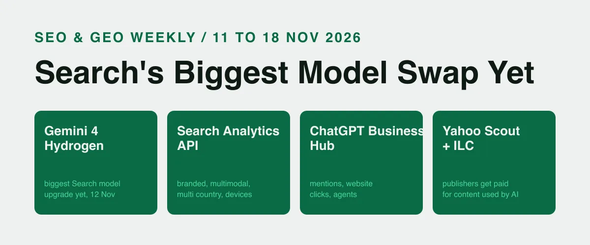

This is the weekly SEO and GEO digest, 11 to 18 November 2026. The theme of the week is plumbing: the model that writes Google's answers was swapped, the report you use to measure AI visibility logged bad data for three days, the API that feeds your dashboards gained the filters you glue together by hand, and ChatGPT began handing out click data. The position at the end is mine and it is blunt.

## Google swaps the model behind Search: Gemini 4 Hydrogen

On 12 November 2026, Google released Gemini 4 Hydrogen in Google Search and is calling it its biggest Search model upgrade yet. [Search Engine Roundtable reported the Google statements](https://www.seroundtable.com/google-search-gemini-4-hydrogen-42526.html): Nick Fox of Google described it as a massive upgrade and Robby Stein said "the biggest model upgrade to Search yet has landed". Google's own material frames what changed: better intent understanding, improved query fan-out and more linking to more of the web, more visual and structured responses, and richer language understanding across AI Mode languages. Status: official, from Google's release as covered by Search Engine Roundtable. It landed while a core update was rolling out, which Google did not connect. My take: the engine that writes your AI Overviews and AI Mode answers changed in one day, so treat every GEO read of "what Google cites" from before this week with caution: the answering model changed in a day, and the report that measures exposure logged bad data for three days. The query fan-out and linking change is the one to watch, because a broader set of cited sources is exactly what a citation gap looks like.

## Google confirms a data bug in the AI performance report

On 12 November 2026, Google confirmed a [data logging error in the Search Console Generative AI performance report for 9 to 11 November](https://searchengineland.com/google-search-console-performance-report-data-bug-nov-9-11-501899), the first days of the core update. Google says the error caused a decrease in reported impressions for that window and that it "affects data logging only", meaning your real performance in AI Mode and AI Overviews was unaffected. Status: official, confirmed by Google through Search Engine Land. My take: if you saw a suspicious AI impressions dip for those three dates and blamed the update or your content, you were reading noise. It is the worst possible week to lose trust in the one number that tells you whether GEO work moved anything, while a core update and a model swap landed together on top of it.

## Search Analytics API gains the filters that were stuck in the UI

On 16 November 2026, Google [announced three additions to the Search Analytics API](https://developers.google.com/search/blog/2026/11/search-analytics-api-update) that had lived only in the Search Console web interface: a branded query classification (BRANDED and NON_BRANDED, available only for eligible properties), a webMultimodal type covering Google Lens, Circle to Search and image uploads (also exported to BigQuery for properties with an active bulk data export), and a filterLists field for several countries or devices in one request. Status: official, from the Google Search Central blog. My take: the useful part is that these filters now combine, so a single call can pull non-branded, mobile-only traffic across a region. Branded versus non-branded is precisely the split you need when an AI answer, not a search result, now carries your name, and being able to automate it changes what a small team can report.

## ChatGPT Business Hub: OpenAI starts handing out click data

On 10 November 2026, the day before this digest's window, OpenAI [launched the ChatGPT Business Hub](https://searchengineland.com/chatgpt-business-hub-is-now-live-501350), letting businesses claim their listing in ChatGPT and unlock analytics on it. Once you claim and verify your business, you see the number of mentions and website clicks you get in ChatGPT, plus discovery topics: the common themes across conversations where your site is cited. Per OpenAI's [announcement](https://openai.com/index/introducing-businesses-chatgpt/), eligible ecommerce and online service businesses in the United States can, in beta, build, test and launch a Business Agent. Status: official, from OpenAI's release and announcement. The detail that matters is the one Barry Schwartz flagged: this is click data, a metric he says Google and Microsoft do not offer in their AI reporting tools. My take: stop guessing whether ChatGPT cites and clicks you. Claiming the listing early and getting the measurement is cheap, and it is the kind of first-hand data that turns a GEO pitch from a promise into a report.

## Yahoo Scout exits beta and publishers get a price for AI use

On 10 November 2026, also before this window, [Yahoo announced Scout exited beta](https://www.yahooinc.com/press/after-delivering-more-than-3-billion-answers-yahoo-scout-exits-beta-to-underpin-all-of-yahoo-search) after delivering more than 3 billion answers since its Q1 launch, now underpinning a rebuilt Yahoo Search that blends traditional results and Scout AI answers in a Pivot view, with Scout assistance across Finance, Sports and News. Two days later the [Internet Licensing Collective](https://www.seroundtable.com/ilc-yahoo-42528.html) launched with more than 3,000 publishers and Yahoo Scout as its first commercial licensee, [paying participating publishers for licensed content used in its AI answers](https://internetcollective.org/press/ilc-launch-2026) under a blanket license that scales with usage. Status: official, from Yahoo and the ILC launch as covered by Search Engine Roundtable. My take: the citation economy just got a price. When an AI engine pays for the content it answers from, being citable stops being only an SEO metric and becomes revenue, which changes the calculus for publishers deciding who to license to and what their pages are worth inside an AI response.

## Open-source GEO you can run yourself

For the open-source pick this week, [GEORank](https://github.com/yaojingang/GEORank) is a self-hosted GEO workbench under Apache-2.0 with 540 stars as of 18 November 2026, built on FastAPI and Next.js, that runs a diagnosis of how visible a site is in AI search and turns it into plans, a question workbench, and structured tools such as JSON-LD and llms.txt generators. My take: after a week of measurement noise, a tool you can run on your own server with your own API keys re-earns trust, because the method is on the page and you can re-check the score yourself.

## What I make of this week

Here is where I stop summarizing and take a position.

The pattern the whole layer that sits between you and the answer engine got re-plumbed at once. The model that writes Google's answers was swapped to Hydrogen, the report you use to judge AI visibility logged bad numbers inside that exact window, the API that feeds your dashboards finally carries branded, multimodal and multi-market filters, ChatGPT began handing out click data, and a publisher collective started charging for the citations AI engines use.

Two things follow. First, trust only what you re-measured this week. The model behind the answers is new and the reporting was broken for three days, so treat any AI visibility number from before this week with caution rather than as a stable baseline. Second, measurement is becoming the moat. ChatGPT now tells you, with click data, how often it cites you, the Search Analytics API lets you separate branded from non-branded at scale, and open-source tools let you run the audit yourself. A hidden blended "visibility score" will not survive a market where the engines themselves publish the clicks.

Here is my line: do not let a week of broken AI reporting, or a model swap, become an excuse for not measuring. The engines are handing you the data if you go claim it and run the query. Take it.

We build search and AI visibility work on verified, first-party measurements. If you want to know what the engines actually cite and say about your brand instead of what a dashboard guesses, [get in touch](/contact/).