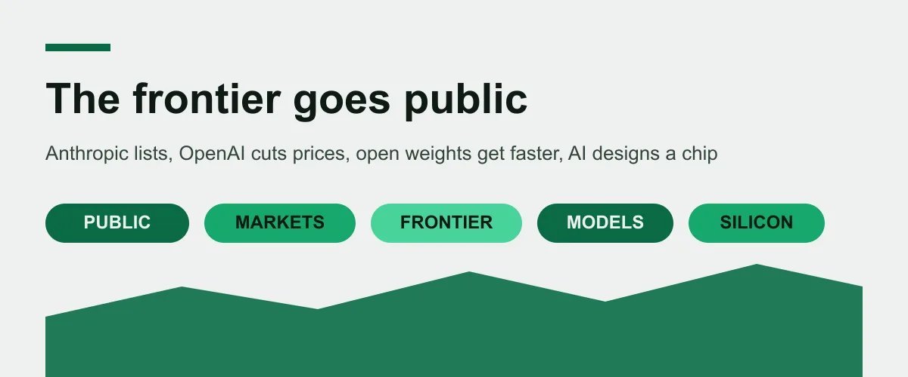

Every Sunday we read what lit up Hacker News and pick the stories that matter to people who build software and run a business. This digest covers 15 to 22 November 2026, and the week had one thread through it: the frontier went public. A frontier lab listed on Nasdaq, two incumbents shipped new models, open weights got cheaper to run, and AI designed a CPU from scratch. Points below are as of 22 November 2026, they move fast and mean little on their own.

## 1. Anthropic's shares start trading on Nasdaq

Anthropic's Class A shares started trading on Nasdaq on November 19 under the ticker ANT ([Reuters](https://www.reuters.com/business/finance/anthropics-historic-debut-put-ais-promise-peril-wall-st-test-2026-11-19/), [CNBC](https://www.cnbc.com/2026/11/19/anthropic-ipo-ant-live-updates.html), 1,140 points on Hacker News, 19 November 2026). The IPO priced at $83 per share. Anthropic's own announcement puts IPO gross proceeds at about $93.5 billion, nearly $91.6 billion of it to the company, plus a $26.0 billion private placement of Class N shares sold to AMD, Broadcom, Google, Micron, Microsoft, NVIDIA, and TSMC ([Anthropic announcement](https://www.anthropic.com/news/ipo-close)). My take: watch the placement, not the fireworks. The chipmakers and clouds that sell Anthropic compute now own a formal seat in its cap table, and from here the public market prices every claim the company makes. That is a new audit regime for a vendor-driven industry.

## 2. OpenAI ships GPT-6.2 Astra and Sol

OpenAI announced GPT-6.2 Astra, its frontier model for the hardest professional work, and GPT-6.2 Sol, its efficient model for everyday tasks ([source](https://openai.com/index/introducing-gpt-6-2-astra-sol/), 1,347 points on Hacker News, 17 November 2026). Astra's API prices are 20% below GPT-6 Astra: $8 per million input tokens, $0.40 for cached input, and $40 for output. On the company's GDPval v2 benchmark, which measures long-horizon workflows in consulting, finance, and design, OpenAI says Astra leads by 6.2 points while using 22% fewer output tokens, and it calls Astra the first externally released model to meet its High threshold for AI self-improvement. Those are the vendor's own measurements, from a company selling the models. My take: the score claims are the marketing, the price cut is the news. Frontier capability is being discounted in plain sight, and the Astra/Sol split is two-tier pricing for the enterprise: pay for the hard task, run the cheap model for everything else.

## 3. Inkling 2 Mini brings open-weights reasoning to a small box

Thinking Machines Lab released Inkling 2 Mini ([source](https://thinkingmachines.ai/news/inkling-2-mini/), 1,425 points on Hacker News, 20 November 2026), an open-weights model that runs the middle layers of the network three times for every token. It has 26.4B total parameters, 3.4B active, and 5.4B weight activations per token, and the company says it leads every open-weights model under 100B parameters on DeepSWE v1.1 (48.2%) and Vals Index v2.2 (46.5%). The company post says researchers at Stanford's Hazy Research Lab and Scaling Intelligence Lab measured its efficiency at 0.703 intelligence per joule on an NVIDIA DGX Spark, ahead of the comparable open models in the same test ([paper](https://arxiv.org/abs/2511.07885)). That figure is the company's statement about the work of the researchers it cites, not a number we verified in the paper's tables. My take: the vendor table flatters, and the efficiency claim is the one worth checking against the paper. Looped reasoning means the model thinks harder without writing a long chain of thought, so it is cheaper to run and your data stays on your own box. For most businesses that is the release of the week.

## 4. Gemini 4 Neon puts steerability and injection resistance first

Google introduced Gemini 4 Neon ([source](https://blog.google/innovation-and-ai/models-and-research/gemini-models/introducing-gemini-4-neon/), 1,061 points on Hacker News, 18 November 2026), a model built around dependable execution rather than raw benchmark pushes. It ranks second on steerability, defined as adapting cleanly to mid-task user corrections, on the new Agent Arena Index; Google reports its lowest fabrication rate yet in internal Antigravity testing; and on Gray Swan's indirect prompt injection benchmark it resisted every attack at its highest thinking level, matching a 0.0% attack success rate. All of those numbers are Google's own. My take: the claim no one leads with is the interesting one. For companies running agents that read the web, resistance to indirect prompt injection is the security story of this cycle, and steerability is the usability story. Just remember the source is the vendor.

## 5. Frostbite: a CPU discovered, designed, and verified by AI

Architect Labs says its AI systems discovered, designed, and verified a general-purpose CPU end to end, from instruction set to final GDS, and named it Frostbite ([source](https://architectlabs.com/blog/frostbite), 671 points on Hacker News, 20 November 2026). The architecture is built on interaction nets, where every computation step is local and every value has one owner, and the company reports a 4.59x performance-per-watt result against a silicon-proven superscalar core across 25 workloads, 15 of them held out until the final evaluation. The formal spec lowered to more than 800k lines of Lean, and the agents iterated over the compiler, ISA, architecture, microarchitecture, RTL, and verification as one system. These are the company's own measurements. The company describes verification through final GDS and delivery on FPGA; no production chip on silicon has been announced, which is our inference from what it publishes, not a claim it makes. My take: do not buy the multiple, buy the process. The credible part is that AI agents worked across the whole stack with a formal contract as the source of truth. That is the pattern every hardware team should copy: verification is not a phase after the design, it is the design.

## What it means for us

Here is where I stop summarizing and take a position.

The week settled one argument and opened another. The settled one: AI is infrastructure. A frontier lab is now a public company with audited numbers, incumbents keep shipping and discounting models, open weights keep compressing cost, and AI is designing the chips that will run it. Capital moved accordingly, and the smartest money in the room took a seat in Anthropic's cap table instead of just buying its compute.

The opened one is about who feeds the machine. The warning this week is an article from May, by Nicolas Bouliane of All About Berlin, that resurfaced on Hacker News: he lost 75% of the site's traffic to Google AI Overviews, with AI answers built from his guides replacing the visits the pages used to get ([source](https://nicolasbouliane.com/blog/death-by-ai), 817 points on Hacker News, 18 November 2026). That is one site owner's report, not a study, but it matches a pattern we keep seeing: the same companies racing to buy AI are the ones whose independent distribution is being eaten by it.

The position: verification is the winning skill. Anthropic's public filing gives everyone a document to audit. Open weights plus an independent Stanford measurement give a second opinion. A chip claim will show up on silicon, or it will not. The customers who check the vendor against the evidence will buy the right models, run them on the right hardware, and keep the distribution they own. The ones who repeat the pitch will rent everything.

We build technology around human judgment for exactly this reason. The human checks the machine, reads the filing, runs the model, and owns the decision. If that trade sounds right for your business, we would love to talk. ([Contact](/contact/))

