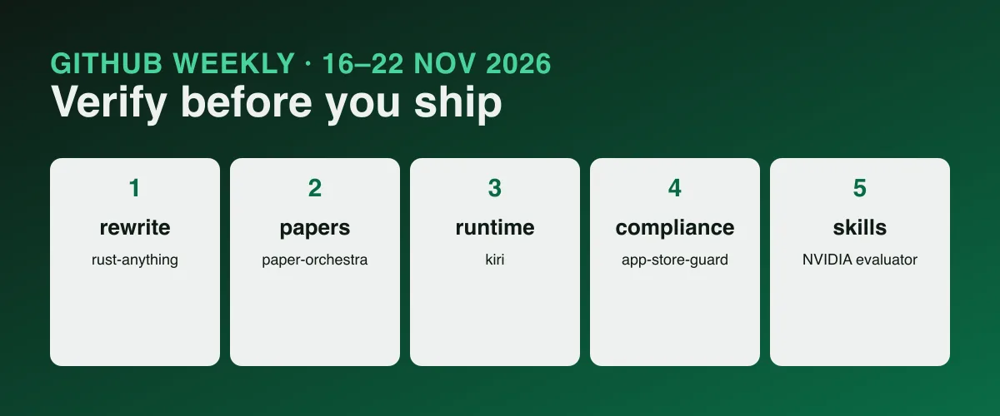

Every Monday we take a lap around [r/BestGitHubRepos](https://www.reddit.com/r/BestGitHubRepos/) and pick five projects worth your time. The bar is simple: real stars, an active repository, and something that changes how you build or create. Here is the set for this week, covering the window from 16 November to 22 November 2026. Stars and release data are as of 23 November 2026, checked on GitHub. Star gains come from the tracker [bestgithubrepositories.com](https://bestgithubrepositories.com/trending/2026/w47), a curator that reads GitHub's daily star history and ranks only repos that were submitted to the subreddit.

## 1. rust-anything, rewrite while it is checked

[rust-anything](https://github.com/erkamyaman/rust-anything) rewrites your app in Rust one piece at a time, checking each step against the original's recorded behavior. It covers CLIs, HTTP servers and libraries in TypeScript, Python, C, Go, Ruby and Java. It is Rust, MIT, with 8,463 stars, and the latest release is [v3.3.0 from 22 November](https://github.com/erkamyaman/rust-anything/releases/tag/v3.3.0). The tracker put it top of the week with roughly +7.7k stars gained. My take: the checkpoint idea is the point. Instead of a big-bang rewrite, each small step is verified against what the old code actually did. That is how migration should work, and it is a template any team moving to a safer language can steal. The caveat is that recorded behavior only captures what you test, so you are still carrying your blind spots with you.

## 2. paper-orchestra, research papers from a team of agents

[PaperOrchestra](https://github.com/google-research/paper-orchestra) is a Google Research framework for automated AI research paper writing: a multi-agent setup that plans, drafts and reviews sections. It is Python, Apache-2.0, with 6,084 stars, and roughly +4.9k gained this week per the tracker. There are no tagged releases yet. My take: I am cautiously interested rather than convinced. Writing a paper that reads well is easy; producing one where the claims, the numbers and the references all hold is hard, and an agent team does not automatically fix that. What is useful is the orchestration itself, how agents divide, critique and merge work. As a skeleton for structured multi-agent generation it is worth studying, not worth trusting for a submission.

## 3. kiri, a small fast runtime with a free tunnel

[Kiri](https://github.com/libracoder/kiri) is a container runtime for macOS, Windows and Linux that pairs container networking with a tunnel that is free for work use, according to the README's own comparison table: Kiri carries the checkmark there, while "paid for larger companies" sits on the Docker Desktop column, not on Kiri. It is Rust, Apache-2.0, with 12,534 stars, and the latest release is [v0.2.2 from 19 November](https://github.com/libracoder/kiri/releases/tag/v0.2.2). Roughly +4.8k gained this week per the tracker. My take: the combination is the story. A single small binary that runs containers and exposes them without paying for a tunnel provider covers a real gap for local development and demos. Running untrusted code in it needs scrutiny, but for dev loops it removes friction. Clean, low tooling, easy to reason about. That is the demo-friendly half of the week.

## 4. app-store-compliance, the rejection handbook

[app-store-compliance](https://github.com/mjmirza/app-store-compliance) is a public playbook and a pre-submission guard for App Store and Google Play: 124 documented rejection reasons to design against. It is Shell, with 4,515 stars, and the latest release is [v2.5.1 from 22 November](https://github.com/mjmirza/app-store-compliance/releases/tag/v2.5.1). Roughly +3.2k gained this week per the tracker. My take: every release team has lived the rejection loop, and a checklist that turns it into a designed-out failure mode is cheap insurance. The value is the collected reasons, not the code. Still, store rules change and rely on reviewer judgment, so treat it as a strong starting point, not a guarantee.

## 5. NVIDIA SkillEvaluator, score a skill before you ship it

[NVIDIA SkillEvaluator](https://github.com/NVIDIA/SkillEvaluator) is a multi-tier framework for evaluating AI agent skills and plugins: quality gates, security scanning, synthetic evaluation data and live agent checks. It is Python, Apache-2.0, with 4,432 stars, and the latest release is [v1.0.1 from 18 November](https://github.com/NVIDIA/SkillEvaluator/releases/tag/v1.0.1). Roughly +2.3k gained this week per the tracker. My take: this is the most relevant repo for anyone shipping agents. As agent skills multiply, the missing piece is a repeatable way to grade them before they reach users. Quality gates plus security scanning is exactly the control layer we argue every agent deploy needs. The framework is young, so expect rough edges, but the direction is right and it comes from a vendor, NVIDIA, with a clear interest in agents running well on its stack, so read the benchmarks with that in mind.

## What connects this week

Five tools, one pattern: verification before you trust. rust-anything checks every migration step against recorded behavior. App-store-compliance turns review rejections into an upfront checklist. NVIDIA's SkillEvaluator grades a skill before it ships. paper-orchestra manages a multi-agent pipeline, and kiri makes local work frictionless. The common thread is not another generation demo. It is proving that what you built actually does what it should, before a user or a reviewer does it for you.

My honest position: the tilt from generation demos toward checking projects is the pattern I am watching. The repos in this list are the ones that gate quality: rewrite checkpoints, evaluation frameworks, rejection playbooks. That matches what we tell clients every day. An agent that proposes is useful. An agent whose output has been checked before it acts is safer. That reading is mine, built on the projects above, not a measured multi-week series.

We are a boutique consultancy that ships AI to clients. We build systems where the agent proposes and a person decides, and we care about control: over models, over data, over deployment. If you want agents that work inside your guardrails, we are here. ([Contact](/contact/))