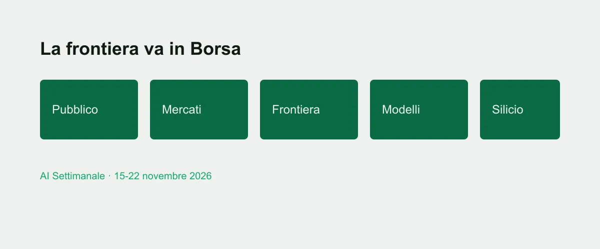

Questa è la traduzione italiana dell'articolo inglese pubblicato il 22 novembre 2026, <a href="https://montedelgallo.com/blog/ai-weekly-20261122-frontier/">AI Weekly: The Frontier Goes Public</a>. La finestra di copertura è quella dell'originale, dal 15 al 22 novembre 2026; i punti qui sotto si riferiscono al 22 novembre 2026, si muovono in fretta e da soli significano poco. Ogni domenica leggiamo ciò che accende Hacker News e scegliamo le storie che contano per chi costruisce software e gestisce un'azienda. La settimana aveva un filo conduttore: la frontiera è andata in Borsa. Un laboratorio di frontiera è quotato su Nasdaq, due incumbent hanno spedito nuovi modelli, gli open weights sono più economici da eseguire e l'AI ha progettato una CPU da zero.

## 1. Le azioni di Anthropic iniziano a essere negoziate su Nasdaq

Le azioni Class A di Anthropic hanno iniziato a essere negoziate su Nasdaq il 19 novembre con il ticker ANT ([Reuters](https://www.reuters.com/business/finance/anthropics-historic-debut-put-ais-promise-peril-wall-st-test-2026-11-19/), [CNBC](https://www.cnbc.com/2026/11/19/anthropic-ipo-ant-live-updates.html), 1.140 punti su Hacker News, 19 novembre 2026). L'IPO è stata prezzata a 83 dollari per azione. L'annuncio della stessa Anthropic porta i proventi lordi dell'IPO a circa 93,5 miliardi di dollari, di cui quasi 91,6 miliardi alla società, più un private placement da 26 miliardi di dollari di azioni Class N vendute ad AMD, Broadcom, Google, Micron, Microsoft, NVIDIA e TSMC ([annuncio Anthropic](https://www.anthropic.com/news/ipo-close)). La mia opinione: guarda il placement, non i fuochi d'artificio. I produttori di chip e i cloud che vendono potenza di calcolo ad Anthropic ora hanno un posto formale nel suo cap table, e d'ora in poi il mercato pubblico dà un prezzo a ogni dichiarazione della società. È un nuovo regime di audit per un settore guidato dai vendor.

## 2. OpenAI spedisce GPT-6.2 Astra e Sol

OpenAI ha annunciato GPT-6.2 Astra, il suo modello di frontiera per il lavoro professionale più difficile, e GPT-6.2 Sol, il modello efficiente per i compiti quotidiani ([fonte](https://openai.com/index/introducing-gpt-6-2-astra-sol/), 1.347 punti su Hacker News, 17 novembre 2026). I prezzi API di Astra sono il 20% sotto GPT-6 Astra: 8 dollari per milione di token in ingresso, 0,40 per il cached input e 40 per l'output. Sul benchmark interno GDPval v2, che misura i workflow a lungo orizzonte in consulenza, finanza e design, OpenAI dice che Astra è in testa con 6,2 punti usando il 22% di token di output in meno, e lo definisce il primo modello rilasciato esternamente a raggiungere la sua soglia High per l'auto-miglioramento dell'AI. Sono misurazioni del vendor, di un'azienda che vende i modelli. La mia opinione: le affermazioni sui punteggi sono marketing, il taglio di prezzo è la notizia. La capacità di frontiera viene scontata in piena vista, e la divisione Astra/Sol è una tariffa a due livelli per l'enterprise: paga per il compito difficile, esegui il modello economico per tutto il resto.

## 3. Inkling 2 Mini porta il ragionamento open-weights in un piccolo box

Thinking Machines Lab ha rilasciato Inkling 2 Mini ([fonte](https://thinkingmachines.ai/news/inkling-2-mini/), 1.425 punti su Hacker News, 20 novembre 2026), un modello open-weights che esegue gli strati centrali della rete tre volte per ogni token. Ha 26,4 miliardi di parametri totali, 3,4 attivi e 5,4 miliardi di attivazioni dei pesi per token, e l'azienda dice che è in testa a ogni modello open-weights sotto i 100 miliardi di parametri su DeepSWE v1.1 (48,2%) e Vals Index v2.2 (46,5%). Il post aziendale afferma che i ricercatori dello Stanford's Hazy Research Lab e Scaling Intelligence Lab da lei citati hanno misurato un'efficienza di 0,703 intelligence per joule su una NVIDIA DGX Spark, davanti ai modelli open comparabili nello stesso test ([paper](https://arxiv.org/abs/2511.07885)). Quella cifra è una dichiarazione dell'azienda sul lavoro dei ricercatori che cita, non un numero che abbiamo verificato noi nelle tabelle del paper. La mia opinione: la tabella del vendor lusinga, e l'affermazione sull'efficienza è quella da controllare sul paper. Il ragionamento a loop significa che il modello pensa più a fondo senza scrivere una lunga catena di pensiero, quindi è più economico da eseguire e i tuoi dati restano sulla tua macchina. Per molte aziende è il rilascio della settimana.

## 4. Gemini 4 Neon mette al primo posto steerability e resistenza alle injection

Google ha presentato Gemini 4 Neon ([fonte](https://blog.google/innovation-and-ai/models-and-research/gemini-models/introducing-gemini-4-neon/), 1.061 punti su Hacker News, 18 novembre 2026), un modello costruito sull'esecuzione affidabile più che sul rincorrere i benchmark. È secondo per steerability, definita come l'adattarsi in modo pulito alle correzioni dell'utente a metà compito, nel nuovo Agent Arena Index; Google riporta il suo più basso tasso di fabbricazione finora nei test interni Antigravity; e sul benchmark Gray Swan di indirect prompt injection ha resistito a ogni attacco al suo livello di pensiero più alto, con un tasso di successo degli attacchi dello 0,0%. Tutti questi numeri sono di Google. La mia opinione: la dichiarazione che nessuno mette in prima pagina è quella interessante. Per le aziende che fanno girare agenti che leggono il web, la resistenza all'indirect prompt injection è la storia di sicurezza di questo ciclo, e la steerability è la storia di usabilità. Ricorda solo che la fonte è il vendor.

## 5. Frostbite: una CPU scoperta, progettata e verificata dall'AI

Architect Labs dice che i suoi sistemi AI hanno scoperto, progettato e verificato una CPU general purpose end to end, dal set di istruzioni al GDS finale, e l'hanno chiamata Frostbite ([fonte](https://architectlabs.com/blog/frostbite), 671 punti su Hacker News, 20 novembre 2026). L'architettura è costruita su interaction nets, dove ogni passo di calcolo è locale e ogni valore ha un solo proprietario, e l'azienda riporta un risultato di 4,59x performance-per-watt contro un core superscalare provato su silicio su 25 workload, 15 dei quali tenuti nascosti fino alla valutazione finale. La specifica formale è scesa a più di 800mila righe di Lean, e gli agenti hanno iterato su compiler, ISA, architettura, microarchitettura, RTL e verifica come un unico sistema. Sono misurazioni della stessa azienda. L'azienda descrive la verifica fino al GDS finale e la consegna su FPGA; nessun chip di produzione su silicio è stato annunciato, ed è una nostra inferenza da ciò che pubblica, non una dichiarazione che fa. La mia opinione: non comprare il multiplo, compra il processo. La parte credibile è che gli agenti AI hanno lavorato su tutta la stack con un contratto formale come fonte di verità. È il pattern che ogni team hardware dovrebbe copiare: la verifica non è una fase dopo il design, è il design.

## Cosa significa per noi

Qui smetto di riassumere e prendo posizione.

La settimana ha chiuso un dibattito e ne ha aperto un altro. Quello chiuso: l'AI è infrastruttura. Un laboratorio di frontiera è ora una società pubblica con numeri sottoposti a revisione, gli incumbent continuano a spedire e scontare modelli, gli open weights continuano a comprimere i costi e l'AI sta progettando i chip che la eseguiranno. Il capitale si è mosso di conseguenza, e il denaro più intelligente nella stanza ha preso un posto nel cap table di Anthropic invece di comprarne solo la potenza di calcolo.

Quello aperto riguarda chi alimenta la macchina. L'avviso di questa settimana è un articolo di maggio, di Nicolas Bouliane di All About Berlin, riemerso su Hacker News: ha perso il 75% del traffico del sito verso Google AI Overviews, con le risposte AI costruite dalle sue guide al posto delle visite che le pagine ricevevano ([fonte](https://nicolasbouliane.com/blog/death-by-ai), 817 punti su Hacker News, 18 novembre 2026). È il racconto di un singolo proprietario di sito, non uno studio, ma combacia con un pattern che continuiamo a vedere: le stesse aziende che corrono a comprare AI sono quelle la cui distribuzione indipendente viene mangiata da essa.

La posizione: la verifica è la skill vincente. Il filing pubblico di Anthropic dà a tutti un documento da controllare. Gli open weights più una misurazione indipendente danno un secondo parere. Una dichiarazione sui chip apparirà su silicio, oppure no. I clienti che controllano il vendor contro l'evidenza compreranno i modelli giusti, li eseguiranno sull'hardware giusto e conserveranno la distribuzione che possiedono. Quelli che ripetono il pitch noleggeranno tutto.

Costruiamo tecnologia intorno al giudizio umano proprio per questa ragione. L'umano controlla la macchina, legge il filing, esegue il modello e possiede la decisione. Se questo tipo di lavoro è giusto per la tua azienda, [parliamone](/contatti/).

