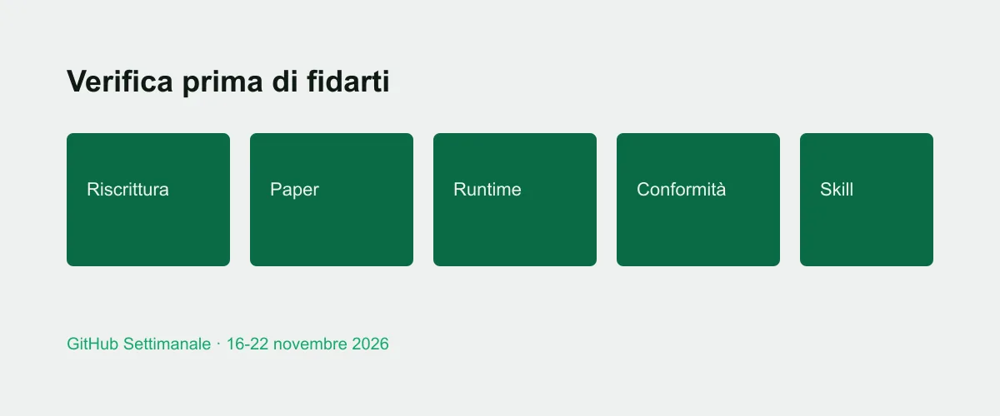

Questa è la traduzione italiana dell'articolo inglese pubblicato il 23 novembre 2026, <a href="https://montedelgallo.com/blog/github-weekly-20261123-verify/">GitHub Weekly: Five Repos Worth Your Attention This Week</a>. La finestra di copertura è quella dell'originale, dal 16 al 22 novembre 2026; stelle e dati di release si riferiscono al 23 novembre 2026 e sono controllati su GitHub. I guadagni di stelle vengono dal tracker [bestgithubrepositories.com](https://bestgithubrepositories.com/trending/2026/w47), un curatore che legge la storia giornaliera delle stelle su GitHub e classifica solo i repository inviati alla subreddit. Ogni lunedì facciamo un giro su [r/BestGitHubRepos](https://www.reddit.com/r/BestGitHubRepos/) e scegliamo cinque progetti che valgono il tuo tempo. La soglia è semplice: stelle reali, un repository attivo e qualcosa che cambia il modo in cui costruisci o crei.

## 1. rust-anything, riscrivi mentre viene verificato

[rust-anything](https://github.com/erkamyaman/rust-anything) riscrive la tua app in Rust un pezzo alla volta, controllando ogni passo contro il comportamento registrato dell'originale. Copre CLI, server HTTP e librerie in TypeScript, Python, C, Go, Ruby e Java. È in Rust, MIT, con 8.463 stelle, e l'ultima release è la [v3.3.0 del 22 novembre](https://github.com/erkamyaman/rust-anything/releases/tag/v3.3.0). Il tracker lo mette in cima alla settimana con circa +7.7k stelle guadagnate. La mia opinione: l'idea dei checkpoint è il punto. Invece di una riscrittura big-bang, ogni piccolo passo è verificato contro ciò che il vecchio codice faceva davvero. È così che dovrebbe funzionare una migrazione, ed è un modello che ogni team che si sposta verso un linguaggio più sicuro può rubare. Il limite è che il comportamento registrato cattura solo ciò che testi, quindi ti porti ancora dietro i tuoi punti ciechi.

## 2. paper-orchestra, paper di ricerca da un team di agenti

[PaperOrchestra](https://github.com/google-research/paper-orchestra) è un framework di Google Research per la scrittura automatizzata di paper di ricerca AI: un setup multi-agente che pianifica, redige e revisiona le sezioni. È in Python, Apache-2.0, con 6.084 stelle, e circa +4.9k guadagnate questa settimana secondo il tracker. Non ci sono ancora release taggate. La mia opinione: sono cautamente interessato, non convinto. Scrivere un paper che si legge bene è facile; produrne uno in cui affermazioni, numeri e riferimenti reggono tutti è difficile, e un team di agenti non lo sistema da solo. L'utile è l'orchestrazione in sé: come gli agenti dividono, criticano e fondono il lavoro. Come scheletro per la generazione multi-agente strutturata vale la pena studiarlo, non fidarsene per una sottomissione.

## 3. kiri, un runtime piccolo e veloce con un tunnel gratuito

[Kiri](https://github.com/libracoder/kiri) è un runtime per container su macOS, Windows e Linux che unisce il networking dei container a un tunnel gratuito per l'uso lavorativo, secondo la tabella comparativa del README: Kiri ha la spunta lì, mentre "a pagamento per le aziende più grandi" è la colonna di Docker Desktop, non di Kiri. È in Rust, Apache-2.0, con 12.534 stelle, e l'ultima release è la [v0.2.2 del 19 novembre](https://github.com/libracoder/kiri/releases/tag/v0.2.2). Circa +4.8k guadagnate questa settimana secondo il tracker. La mia opinione: la combinazione è la storia. Un singolo binario piccolo che esegue container e li espone senza pagare un provider di tunnel copre un vuoto reale per lo sviluppo locale e le demo. Eseguire codice non fidato richiede attenzione, ma per i loop di sviluppo toglie attrito. Pulito, poco tooling, facile da ragionare. È la metà demo-friendly della settimana.

## 4. app-store-compliance, il manuale delle rejection

[app-store-compliance](https://github.com/mjmirza/app-store-compliance) è un playbook pubblico e una guardia pre-invio per App Store e Google Play: 124 motivi di rejection documentati contro cui progettare. È in Shell, con 4.515 stelle, e l'ultima release è la [v2.5.1 del 22 novembre](https://github.com/mjmirza/app-store-compliance/releases/tag/v2.5.1). Circa +3.2k guadagnate questa settimana secondo il tracker. La mia opinione: ogni team di release ha vissuto il loop delle rejection, e una checklist che lo trasforma in un failure mode progettato è un'assicurazione a basso costo. Il valore sono i motivi raccolti, non il codice. Comunque le regole degli store cambiano e dipendono dal giudizio dei reviewer, quindi trattalo come un punto di partenza solido, non come una garanzia.

## 5. NVIDIA SkillEvaluator, valuta una skill prima di spedirla

[NVIDIA SkillEvaluator](https://github.com/NVIDIA/SkillEvaluator) è un framework multi-livello per valutare skill e plugin di agenti AI: quality gates, scansione di sicurezza, dati di valutazione sintetici e controlli sugli agenti live. È in Python, Apache-2.0, con 4.432 stelle, e l'ultima release è la [v1.0.1 del 18 novembre](https://github.com/NVIDIA/SkillEvaluator/releases/tag/v1.0.1). Circa +2.3k guadagnate questa settimana secondo il tracker. La mia opinione: è il repository più rilevante per chi spedisce agenti. Mentre le skill si moltiplicano, il pezzo mancante è un modo ripetibile di valutarle prima che arrivino agli utenti. Quality gates più scansione di sicurezza è esattamente il livello di controllo che sosteniamo serva a ogni deploy di agenti. Il framework è giovane, quindi aspettati spigoli, ma la direzione è giusta e viene da un vendor, NVIDIA, con un interesse evidente a che gli agenti giri bene sul suo stack: leggi i benchmark con questo in mente.

## Cosa collega questa settimana

Cinque strumenti, un pattern: verifica prima di fidarti. rust-anything controlla ogni passo di migrazione contro il comportamento registrato. app-store-compliance trasforma le rejection in una checklist a monte. NVIDIA SkillEvaluator valuta una skill prima che vada in produzione. paper-orchestra gestisce una pipeline multi-agente, e kiri rende il lavoro locale senza attrito. Il filo comune non è un'altra demo di generazione. È dimostrare che ciò che hai costruito fa davvero quello che deve, prima che lo faccia un utente o un reviewer al posto tuo.

La mia posizione onesta: la piega dalle demo di generazione ai progetti di verifica è il pattern che sto osservando. I repository in questa lista sono quelli che mettono un gate sulla qualità: checkpoint di riscrittura, framework di valutazione, playbook di rejection. Combacia con ciò che diciamo ogni giorno ai clienti. Un agente che propone è utile. Un agente il cui output è stato controllato prima di agire è più sicuro. Quella lettura è mia, costruita sui progetti qui sopra, non una serie multi-settimana misurata.

Siamo una boutique consultancy che porta l'AI ai clienti. Costruiamo sistemi in cui l'agente propone e una persona decide, e ci interessa il controllo: su modelli, su dati, su deployment. Se vuoi agenti che lavorino dentro le tue guardrail, [siamo qui](/contatti/).