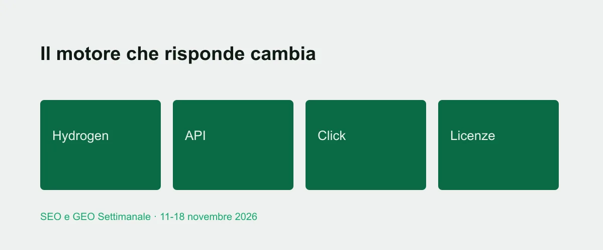

Questa è la traduzione italiana dell'articolo inglese pubblicato il 18 novembre 2026, <a href="https://montedelgallo.com/blog/seo-geo-weekly-20261118-hydrogen/">SEO and GEO Weekly: Google Swaps the Engine That Answers</a>. La finestra di copertura è quella dell'originale, dall'11 al 18 novembre 2026; metriche e punti sono gli snapshot di quelle date, non valori di oggi. Il tema della settimana è la pipeline: il modello che scrive le risposte di Google è cambiato, il report che usi per misurare la visibilità AI ha registrato dati sbagliati per tre giorni, l'API che alimenta le dashboard ha ricevuto i filtri che assembli a mano e ChatGPT ha iniziato a dare i dati sui click. La posizione finale è mia ed è netta.

## Google cambia il modello dietro Search: Gemini 4 Hydrogen

Il 12 novembre 2026 Google ha rilasciato Gemini 4 Hydrogen in Google Search e lo definisce il suo più grande aggiornamento del modello di Search finora. [Search Engine Roundtable ha riportato le dichiarazioni di Google](https://www.seroundtable.com/google-search-gemini-4-hydrogen-42526.html): Nick Fox di Google lo ha descritto come un aggiornamento massiccio e Robby Stein ha detto che "il più grande aggiornamento del modello di Search è arrivato". Il materiale di Google spiega cosa cambia: migliore comprensione dell'intento, query fan-out e linking più estesi verso il web, risposte più visive e strutturate e comprensione linguistica più ricca nelle lingue di AI Mode. Status: ufficiale, dal rilascio di Google riportato da Search Engine Roundtable. È arrivato mentre era in corso un core update, che Google non ha collegato. La mia opinione: il motore che scrive le tue AI Overviews e le risposte di AI Mode è cambiato in un giorno, quindi tratta con cautela ogni lettura GEO di "ciò che Google cita" precedente a questa settimana: il modello che risponde è cambiato in un giorno e il report che misura l'esposizione ha registrato dati sbagliati per tre giorni. Il cambiamento di query fan-out e linking è quello da osservare, perché un insieme più ampio di fonti citate è esattamente come appare un citation gap.

## Google conferma un bug di dati nel report AI

Il 12 novembre 2026 Google ha confermato un [errore di logging nel report Generative AI di Search Console per il 9-11 novembre](https://searchengineland.com/google-search-console-performance-report-data-bug-nov-9-11-501899), i primi giorni del core update. Google dice che l'errore ha ridotto le impression riportate in quella finestra e che "riguarda solo il logging dei dati", cioè la tua performance reale in AI Mode e AI Overviews non è stata toccata. Status: ufficiale, confermato da Google attraverso Search Engine Land. La mia opinione: se in quelle tre date hai visto un calo sospetto di impression AI e hai dato la colpa all'update o ai tuoi contenuti, stavi leggendo rumore. È la settimana peggiore possibile per perdere fiducia nell'unico numero che ti dice se il lavoro GEO ha mosso qualcosa, mentre un core update e un cambio di modello arrivavano insieme sopra di esso.

## L'API Search Analytics riceve i filtri rimasti bloccati nella UI

Il 16 novembre 2026 Google ha [annunciato tre aggiunte all'API Search Analytics](https://developers.google.com/search/blog/2026/11/search-analytics-api-update) che prima vivevano solo nell'interfaccia web di Search Console: una classificazione delle query branded (BRANDED e NON_BRANDED, disponibile solo per le proprietà eleggibili), un tipo webMultimodal che copre Google Lens, Circle to Search e gli upload di immagini (esportato anche in BigQuery per le proprietà con un'esportazione bulk attiva) e un campo filterLists per più paesi o dispositivi in una sola richiesta. Status: ufficiale, dal blog Google Search Central. La mia opinione: la parte utile è che questi filtri ora si combinano, quindi una singola chiamata può estrarre il traffico non-branded, solo mobile, su una regione. Branded contro non-branded è esattamente la distinzione che ti serve quando un nome ora viaggia in una risposta AI, non in un risultato di ricerca, e automatizzarla cambia ciò che un piccolo team può riportare.

## ChatGPT Business Hub: OpenAI inizia a dare i dati sui click

Il 10 novembre 2026, il giorno prima della finestra di questo digest, OpenAI ha [lanciato ChatGPT Business Hub](https://searchengineland.com/chatgpt-business-hub-is-now-live-501350), che permette alle aziende di rivendicare la propria scheda in ChatGPT e sbloccarne le statistiche. Una volta rivendicata e verificata la scheda, vedi il numero di menzioni e di click sul sito che ricevi in ChatGPT, più i discovery topics: i temi comuni nelle conversazioni in cui il tuo sito viene citato. Per l'[annuncio](https://openai.com/index/introducing-businesses-chatgpt/) di OpenAI, le attività di ecommerce e i servizi online eleggibili negli Stati Uniti possono, in beta, costruire, testare e lanciare un Business Agent. Status: ufficiale, dal rilascio e dall'annuncio di OpenAI. Il dettaglio che conta è quello segnalato da Barry Schwartz: sono dati sui click, una metrica che secondo lui Google e Microsoft non offrono nei loro strumenti di report AI. La mia opinione: smetti di indovinare se ChatGPT ti cita e ti clicca. Rivendicare presto la scheda e ottenere la misurazione costa poco, ed è il tipo di dato di prima mano che trasforma una proposta GEO da promessa in report.

## Yahoo Scout esce dalla beta e gli editori ottengono un prezzo per l'uso dell'AI

Il 10 novembre 2026, sempre prima di questa finestra, [Yahoo ha annunciato l'uscita di Scout dalla beta](https://www.yahooinc.com/press/after-delivering-more-than-3-billion-answers-yahoo-scout-exits-beta-to-underpin-all-of-yahoo-search) dopo aver fornito più di 3 miliardi di risposte dal lancio del Q1, ora alla base di una nuova Yahoo Search che unisce risultati tradizionali e risposte AI di Scout in una vista Pivot, con l'assistenza di Scout in Finance, Sports e News. Due giorni dopo è partita la [Internet Licensing Collective](https://www.seroundtable.com/ilc-yahoo-42528.html) con più di 3.000 editori e Yahoo Scout come primo licensee commerciale, [che paga gli editori partecipanti per i contenuti licenziati usati nelle risposte AI](https://internetcollective.org/press/ilc-launch-2026) con una licenza blanket che scala con l'uso. Status: ufficiale, dal lancio di Yahoo e ILC riportato da Search Engine Roundtable. La mia opinione: l'economia delle citazioni ha appena ricevuto un prezzo. Quando un motore AI paga per il contenuto da cui risponde, essere citabili smette di essere solo una metrica SEO e diventa ricavo, e questo cambia il calcolo degli editori che decidono a chi dare in licenza e quanto valgono le proprie pagine dentro una risposta AI.

## GEO open source che puoi eseguire da solo

Per la scelta open source di questa settimana, [GEORank](https://github.com/yaojingang/GEORank) è un workbench GEO self-hosted con licenza Apache-2.0 e 540 stelle al 18 novembre 2026, costruito su FastAPI e Next.js, che esegue una diagnosi di quanto un sito è visibile nella ricerca AI e la trasforma in piani, un question workbench e strumenti strutturati come i generatori JSON-LD e llms.txt. La mia opinione: dopo una settimana di rumore di misurazione, uno strumento che puoi eseguire sul tuo server con le tue chiavi API riconquista fiducia, perché il metodo è sulla pagina e puoi ricontrollare tu stesso il punteggio.

## Cosa penso di questa settimana

Qui smetto di riassumere e prendo posizione.

Tutta la fascia che sta tra te e il motore di risposta è stata ri-condutturata in una volta. Il modello che scrive le risposte di Google è passato a Hydrogen, il report che usi per giudicare la visibilità AI ha registrato numeri sbagliati proprio in quella finestra, l'API che alimenta le dashboard ha finalmente i filtri branded, multimodali e multi-mercato, ChatGPT ha iniziato a dare i dati sui click e una collettiva di editori ha iniziato a far pagare le citazioni usate dai motori AI.

Ne conseguono due cose. Primo, fidati solo di ciò che hai rimisurato questa settimana. Il modello dietro le risposte è nuovo e il report è stato rotto per tre giorni, quindi tratta con cautela ogni numero di visibilità AI precedente a questa settimana, non come una baseline stabile. Secondo, la misurazione sta diventando il fossato. ChatGPT ora ti dice, con i dati sui click, quanto spesso ti cita, l'API Search Analytics ti separa il branded dal non-branded su scala e gli strumenti open source ti fanno eseguire l'audit da solo. Uno "visibility score" blended e nascosto non sopravviverà in un mercato dove sono i motori stessi a pubblicare i click.

Ecco la mia linea: non lasciare che una settimana di report AI rotti, o un cambio di modello, diventi una scusa per non misurare. I motori ti stanno dando i dati se vai a prenderli ed esegui la query. Prendili.

Costruiamo lavoro di search e visibilità AI su misurazioni verificate e di prima parte. Se vuoi sapere cosa citano e dicono davvero i motori sul tuo brand invece di ciò che una dashboard immagina, [scrivici](/contatti/).